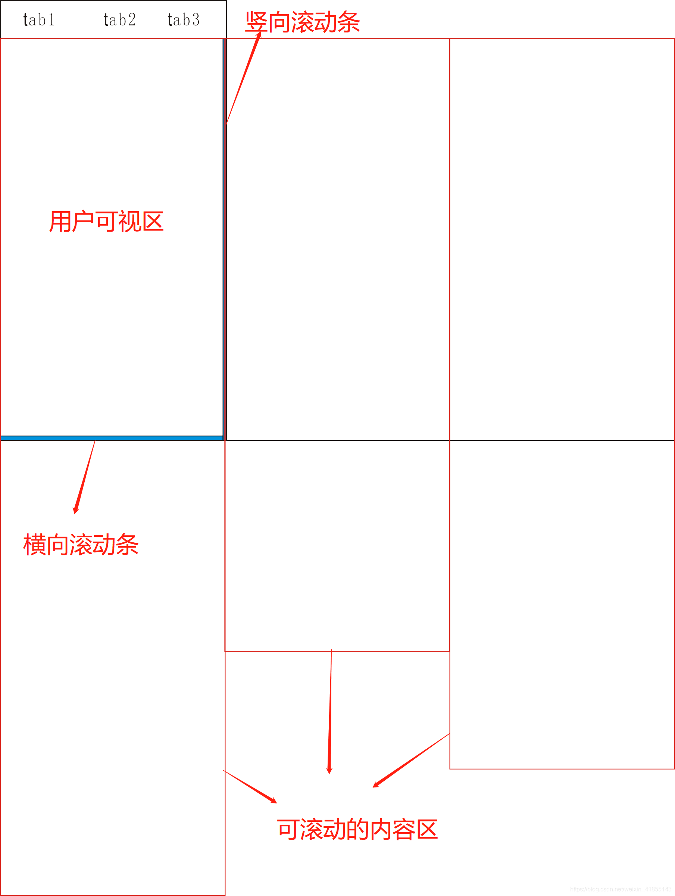

&nbsp;&nbsp;&nbsp;淘宝的tabContainer是一个值得学习的组件，本文介绍自己对淘宝tabContainer的研究，实现一个tabContainer组件。

#### 首先体验一下淘宝的tabContainer组件


#### 失败的尝试
一开始的想法是横向纵向都用滚动的方式

这个方案在chrome浏览器打开手机调试工具时，两个方向都能实现滚动，且滚动时另一个方向不会滚动。但是在手机safari浏览器就无法进行横向滚动，有兼容性问题，因此放弃。

#### 换种方式实现 

既然横向滚动无法实现，那么通过拖拽的方式能否实现横向移动呢？然后我就将横向的滚动条去掉了，横向通过`touchstart`、`touchmove`、`touchend`的三个事件和`left`属性来控制横向的移动。

附上源码：

```javascript
export default {
  methods: {
    touchStart (e) {
      this.isSliding = false; // 取消滑动动画
      // 获取起始坐标
      this.initX = e.changedTouches[0].clientX;
      this.initY = e.changedTouches[0].clientY;
      // 获取起始时间点
      this.initTime = Date.now();
    },
    touching (e) {
      if (this.moveType === 0) { // 判断是横向移动还是纵向移动
      	// 横纵向的移动距离
        let deltaX = e.changedTouches[0].clientX - this.initX;
        let deltaY = e.changedTouches[0].clientY - this.initY;
        // 判断滑动的距离，横向移动大于纵向移动，则禁止纵向滑动，允许横向移动，反之亦然
        if (Math.abs(deltaX) > Math.abs(deltaY)) this.moveType = this.MOVE_TYPE_ROW;
        else this.moveType = this.MOVE_TYPE_COL;
      } else if (this.moveType === this.MOVE_TYPE_ROW) { // 横向移动
        // 阻止默认动作，即不允许纵向移动
        e.preventDefault();

        this.left = e.changedTouches[0].clientX - this.initX;
        // 限制横向移动不要超出范围
        if (this.initLeft + this.left > 0) this.left = 0;
        else if (this.initLeft + this.left < -this.contentBoxWidth * (this.navList.length - 1)) this.left = - this.contentBoxWidth * (this.navList.length - 1);
        else this.left = this.left + this.initLeft
      } 
    },
    touchEnd (e) {
      // 横向移动的处理
      if (this.moveType === this.MOVE_TYPE_ROW) {
        // 计算滑动速度
        let ms = Date.now() - this.initTime;
        let left = e.changedTouches[0].clientX - this.initX;
        let speed = left / ms;
        
        if (speed > this.SPEED_LIMIT) { // 右滑速度超过限制，左移一个tab
          this.currentIdx--;
          if (this.currentIdx < 0) this.currentIdx = 0;
        } else if (speed < -this.SPEED_LIMIT) { // 左滑速度超过限制，右移一个tab
          this.currentIdx++;
          if (this.currentIdx > this.navList.length - 1) this.currentIdx = this.navList.length - 1;
        } else { // 移动距离超过半个tab，跳到下一个tab
          this.currentIdx = Math.abs(parseInt((this.left - this.contentBoxWidth / 2) / this.contentBoxWidth));

        }
        // 使内容区移动到对应的tab页面
        this.left = this.initLeft = -this.contentBoxWidth * this.currentIdx;
      }
      // 恢复默认值
      this.isSliding = true;
      this.moveType = 0;
      this.initLeft = this.left;
    }
  }
}
```

源码可以跳转[Github](https://github.com/gxsandzxl/ziv-vue#tab-container)查看，有用的话请点个赞呀 ！