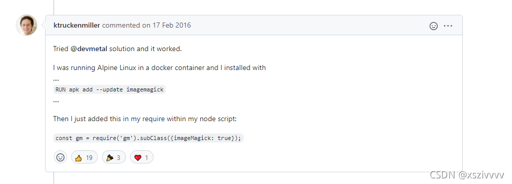

### 前言
Node.js项目需要生成缩略图，由于Node.js本身无法处理，需要用到`GraphicsMagick`工具，于是开始网上找工具，中间踩了一些坑，于是记录下来。

### 安装GraphicsMagick
安装这个工具没有难度，按照[nodejs使用graphicsmagick生成缩略图](https://juejin.cn/post/6865262565288198158)步骤操作即可。
当我使用[Node.js的gm模块](https://github.com/aheckmann/gm)去处理缩略图的时候，遇到了问题。
直接使用Node.js跑脚本，能成功处理图片。当在使用了`pm2`管理的项目中跑相同的代码时却报了以下错误
```
Error: Could not execute GraphicsMagick/ImageMagick: gm "convert" "/xxx/xxx.jpg" "-resize" "200x" "/xxx/xxx.jpg" this most likely means the gm/convert binaries can't be found
```
在`gm`的[issue](https://github.com/aheckmann/gm/issues/455)下有很多人遇到相关的问题，找到了这个方案

在其他方案无效的情况下，我尝试了这个方案
### 安装ImageMagick
参考[在CentOS中编译安装ImageMagick](https://www.maixj.net/ict/centos-imagemagick-22650)安装工具，并在代码中添加`const gm = require('gm').subClass({imageMagick: true});`
测试，没有报错，问题解决！

### 参考文献
[Github Issue](https://github.com/aheckmann/gm/issues/455)
[nodejs使用graphicsmagick生成缩略图](https://juejin.cn/post/6865262565288198158)
[在CentOS中编译安装ImageMagick](https://www.maixj.net/ict/centos-imagemagick-22650)